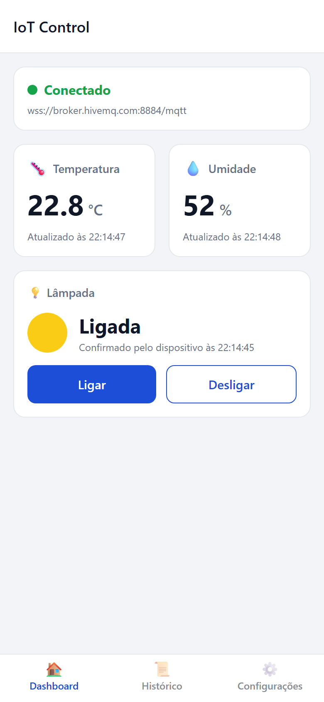
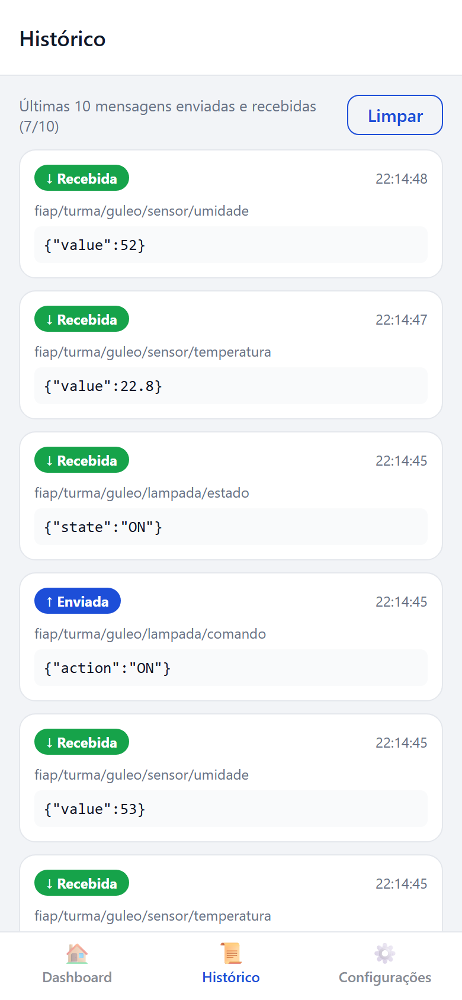
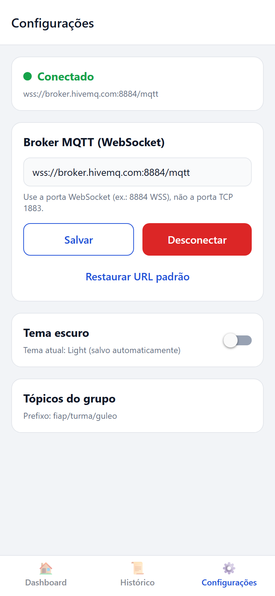
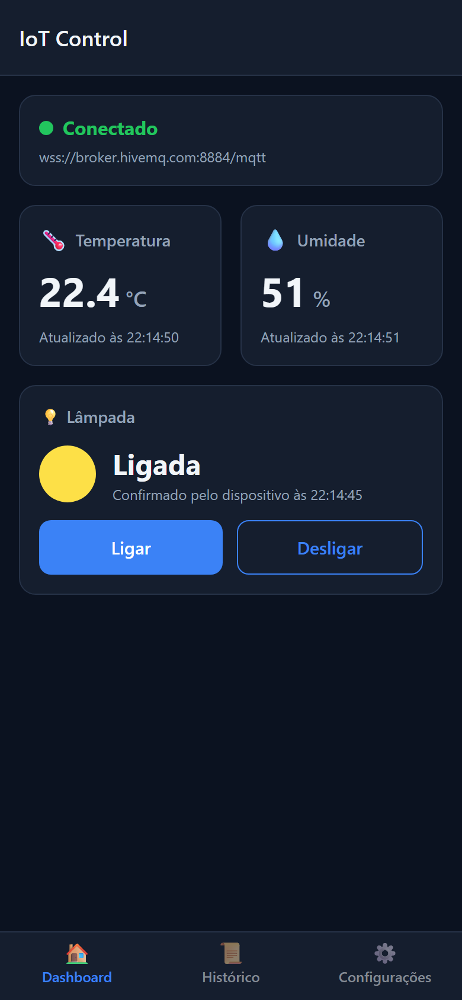
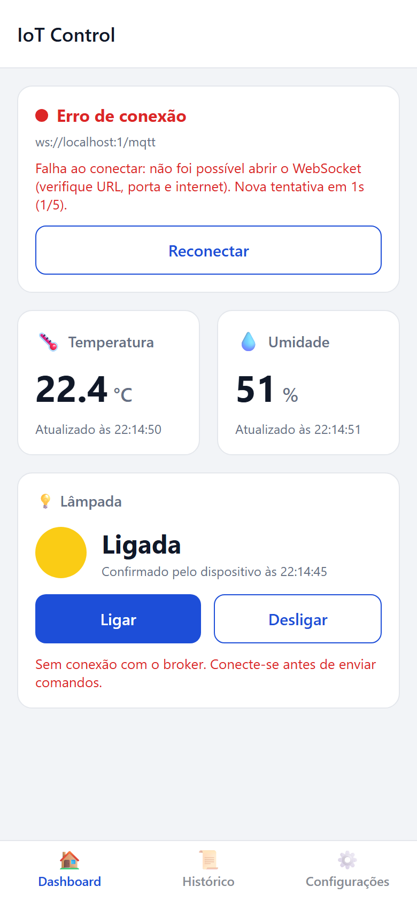

# IoT Control — Painel MQTT em React Native

Checkpoint 3 — Mobile Development & IoT (FIAP)

## Integrantes

| Nome completo | RM |
|---|---|
| Leonardo de Farias | RM555211 |
| Gustavo Laur | RM556603 |

## Descrição e objetivo

O **IoT Control** é um aplicativo mobile que monitora e controla um ambiente inteligente simulado por meio do protocolo **MQTT**, demonstrando o modelo **publish/subscribe**:

- **recebe em tempo real** leituras de temperatura e umidade publicadas por um dispositivo;
- **publica comandos** para ligar e desligar uma lâmpada virtual;
- exibe o estado da lâmpada **somente após a confirmação** publicada pelo dispositivo no tópico de estado;
- mantém o histórico das 10 últimas mensagens enviadas e recebidas;
- salva a URL do broker e o tema (Light/Dark) com AsyncStorage.

Não é necessário hardware: o script [simulator/simulator.js](simulator/simulator.js) faz o papel do dispositivo.

## Tecnologias e versões

| Tecnologia | Versão |
|---|---|
| Expo SDK | 58.0.16 |
| React Native | 0.88.0 |
| React | 19.3.0 |
| TypeScript | 6.0.3 (modo `strict`) |
| paho-mqtt (cliente MQTT sobre WebSocket) | 1.1.0 |
| @react-navigation/native + bottom-tabs | 7.5.1 / 7.21.0 |
| @react-native-async-storage/async-storage | 2.2.0 |
| Node.js (ambiente de desenvolvimento e simulador) | 24.x |
| mqtt.js (somente no simulador) | 5.16.1 |

A biblioteca **paho-mqtt** foi escolhida por ser JavaScript puro sobre WebSocket: funciona no **Expo Go (Android e iOS)** e na **Web** sem módulos nativos nem polyfills.

## Instalação e execução

Pré-requisitos: Node.js 20+ e o app **Expo Go** no celular (ou emulador Android/simulador iOS).

```bash
git clone <url-deste-repositorio>
cd cp6-mobile-mqtt
npm install
npx expo start
```

- **Android/iOS:** escaneie o QR Code com o Expo Go (o celular precisa ter acesso à internet).
- **Web:** pressione `w` no terminal do Expo ou rode `npm run web`.

Ao abrir, o app carrega as preferências salvas e conecta automaticamente ao broker.

## Broker MQTT

| Item | Valor |
|---|---|
| Broker | HiveMQ Public Broker |
| URL WebSocket usada pelo app | `wss://broker.hivemq.com:8884/mqtt` |
| Protocolo / porta | **WSS (WebSocket seguro), porta 8884**, caminho `/mqtt` |
| Autenticação | Nenhuma (broker público) |

> **Atenção:** a porta **1883 é MQTT sobre TCP** e **não funciona** no aplicativo. O app só se conecta por WebSocket (`ws://` ou `wss://`). O simulador usa a mesma URL WSS por padrão.

A URL pode ser alterada em **Configurações** e fica salva no dispositivo. Outras opções públicas por WebSocket:

- `wss://broker.emqx.io:8084/mqtt`
- `wss://test.mosquitto.org:8081/`

O formato esperado é `ws(s)://host:porta/caminho`, e o caminho é obrigatório.

## Tópicos MQTT

Prefixo exclusivo do grupo: **`fiap/turma/guleo`**, definido em [src/config/topics.ts](src/config/topics.ts). Para trocar, altere `GROUP_PREFIX` no app e use `TOPIC_PREFIX` no simulador.

| Tópico | Direção no app | Quem publica | Payload | QoS / retain |
|---|---|---|---|---|
| `fiap/turma/guleo/sensor/temperatura` | Subscribe | Simulador | `{"value":24.5}` | 1 / não |
| `fiap/turma/guleo/sensor/umidade` | Subscribe | Simulador | `{"value":58}` | 1 / não |
| `fiap/turma/guleo/lampada/comando` | **Publish** | App | `{"action":"ON"}` ou `{"action":"OFF"}` | 1 / não |
| `fiap/turma/guleo/lampada/estado` | Subscribe | Simulador | `{"state":"ON"}` ou `{"state":"OFF"}` | 1 / **sim** |

**Validação:** o app só aceita `value` numérico finito nos sensores e `state` igual a `ON`/`OFF` na lâmpada. Mensagens inválidas (ex.: `abc`) não alteram a tela nem derrubam o app. Elas aparecem no histórico marcadas como "Payload inválido".

## Simulador do dispositivo

### Opção 1: script Node.js (recomendado)

Em **outro terminal**:

```bash
cd simulator
npm install
npm start
```

O simulador:

- publica temperatura e umidade a cada 5 segundos, com pequenas variações aleatórias;
- se inscreve em `lampada/comando` e, ao receber `{"action":"ON"|"OFF"}`, publica o novo estado em `lampada/estado`;
- publica o estado inicial da lâmpada (`OFF`) como mensagem retida, para o app conhecê-lo ao conectar.

Atalhos de teclado no terminal do simulador:

| Tecla | Ação |
|---|---|
| `t` | publica uma temperatura imediatamente |
| `u` | publica uma umidade imediatamente |
| `l` | alterna a lâmpada localmente e publica o estado |
| `i` | publica um payload inválido (`abc`) para testar a validação |
| `q` | encerra |

Variáveis de ambiente opcionais:

```bash
# PowerShell
$env:BROKER_URL="wss://broker.emqx.io:8084/mqtt"; $env:TOPIC_PREFIX="fiap/turma/guleo"; $env:INTERVAL_MS="3000"; npm start
# bash
BROKER_URL=wss://broker.emqx.io:8084/mqtt TOPIC_PREFIX=fiap/turma/guleo INTERVAL_MS=3000 npm start
```

### Opção 2: cliente MQTT manual (MQTTX ou HiveMQ WebSocket Client)

1. Abra o [HiveMQ WebSocket Client](https://www.hivemq.com/demos/websocket-client/) ou o [MQTTX](https://mqttx.app/).
2. Conecte em `broker.hivemq.com`, porta `8884`, SSL ligado e caminho `/mqtt`.
3. Inscreva-se em `fiap/turma/guleo/lampada/comando`.
4. Publique em `fiap/turma/guleo/sensor/temperatura` o payload `{"value":24.5}`.
5. Publique em `fiap/turma/guleo/sensor/umidade` o payload `{"value":58}`.
6. Quando chegar `{"action":"ON"}` no tópico de comando, publique em `fiap/turma/guleo/lampada/estado` o payload `{"state":"ON"}`. Faça o mesmo para `OFF`.

## Roteiro de verificação (ciclo completo)

1. Inicie o app (`npx expo start`) e o simulador (`cd simulator && npm start`).
2. No **Dashboard**, o status muda de *Conectando...* para *Conectado*.
3. O simulador publica uma **temperatura** e o card atualiza sozinho, com o horário.
4. O simulador publica uma **umidade** e o card atualiza sozinho.
5. Toque em **Ligar**. O botão mostra carregamento ("aguardando confirmação") e o simulador registra `← .../lampada/comando {"action":"ON"}`.
6. O simulador publica `{"state":"ON"}` e o app mostra **Ligada**.
7. Toque em **Desligar**. O fluxo se repete e o app mostra **Desligada**.
8. Em **Histórico**, aparecem as mensagens com direção (↑ Enviada / ↓ Recebida), tópico, payload e horário.

Testes extras:

- **Sem conexão:** em Configurações toque em *Desconectar* e depois em *Ligar* no Dashboard. Aparece uma mensagem de erro e nada é publicado.
- **Sem confirmação:** pare o simulador e toque em *Ligar*. Após 8 s aparece um aviso de que o dispositivo não confirmou, e o estado da lâmpada não muda.
- **Erro de conexão:** informe uma URL inválida (ex.: `ws://localhost:1/mqtt`). O status vai para *Erro de conexão*, há até 5 tentativas automáticas (1s, 2s, 4s, 8s, 16s) e depois o botão **Reconectar**.
- **Preferências:** troque o tema e a URL e recarregue o app. Ambos são restaurados.

## Telas

> Prints capturados na versão Web (viewport de celular 390×844), com o simulador em execução e o broker HiveMQ público.

| Dashboard | Histórico | Configurações |
|---|---|---|
|  |  |  |

| Dashboard (Dark) | Erro de conexão |
|---|---|
|  |  |

### Funcionalidades por tela

- **Dashboard:** status da conexão (conectando, conectado, desconectado, erro) com URL do broker, mensagem de erro e botão *Reconectar*. Mostra os cards de temperatura e umidade com o último valor e horário, e o controle da lâmpada com os botões Ligar/Desligar, indicador de confirmação pendente e feedback de erro.
- **Histórico:** as 10 mensagens mais recentes (enviadas e recebidas), atualizadas em tempo real, com opção de limpar.
- **Configurações:** campo da URL WebSocket com validação, botões *Salvar*, *Conectar/Desconectar*, *Parar tentativas* e *Restaurar URL padrão*, além da troca de tema Light/Dark.

## Organização do código

```text
App.tsx                      # Providers + navegação por abas (React Navigation)
src/
  config/topics.ts           # prefixo do grupo, tópicos, broker padrão
  types/mqtt.ts              # tipos de status, mensagens, payloads, listeners
  services/
    mqttService.ts           # comunicação MQTT (Paho) isolada da UI, reconexão, publish/subscribe
    storageService.ts        # AsyncStorage (URL do broker e tema)
  context/
    MqttContext.tsx          # estado global MQTT (useState/useEffect), histórico, comandos
    ThemeContext.tsx         # tema Light/Dark persistido
  components/                # SensorCard, ConnectionStatus, LampControl, MessageItem, Card, Button
  screens/                   # DashboardScreen, HistoryScreen, SettingsScreen
  themes/colors.ts           # paletas Light e Dark
  utils/                     # validação de payload/URL e formatação de horário
simulator/simulator.js       # dispositivo IoT simulado (Node.js + mqtt.js)
```

**Gerenciamento de listeners:** `mqttService.onStatus` e `mqttService.onMessage` retornam uma função de cancelamento. O `MqttContext` registra os listeners em um único `useEffect`, e a função de limpeza remove os listeners, cancela timers e desconecta. Ao reconectar ou desconectar, o serviço cancela as inscrições dos tópicos, encerra o cliente anterior e ignora callbacks de clientes antigos (contador de geração). Assim não há eventos duplicados.

## Limitações e observações

- O broker HiveMQ público é **compartilhado e sem autenticação**: qualquer pessoa que conheça os tópicos pode ler ou publicar. Por isso o prefixo do grupo deve ser exclusivo. Não use dados sensíveis.
- Nenhuma senha, token ou credencial foi incluída no repositório.
- É necessário acesso à internet no celular ou computador e no simulador. Redes que bloqueiam WebSocket na porta 8884 impedem a conexão. Nesse caso, teste outro broker ou outra rede.
- O histórico e as últimas leituras ficam apenas em memória e são perdidos ao fechar o app. Apenas a URL e o tema são persistidos, como pede o enunciado.
- Paho-MQTT exige o caminho na URL (ex.: `/mqtt`). URLs sem caminho são rejeitadas pela validação.
- Em segundo plano, o sistema operacional pode suspender o WebSocket. Ao voltar, use *Reconectar* se necessário.
